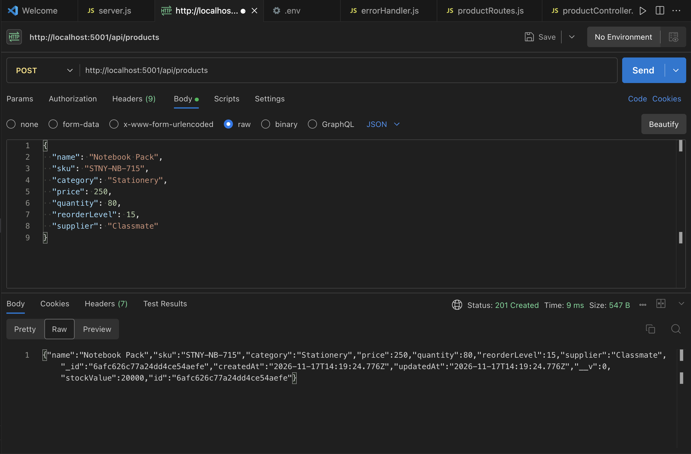
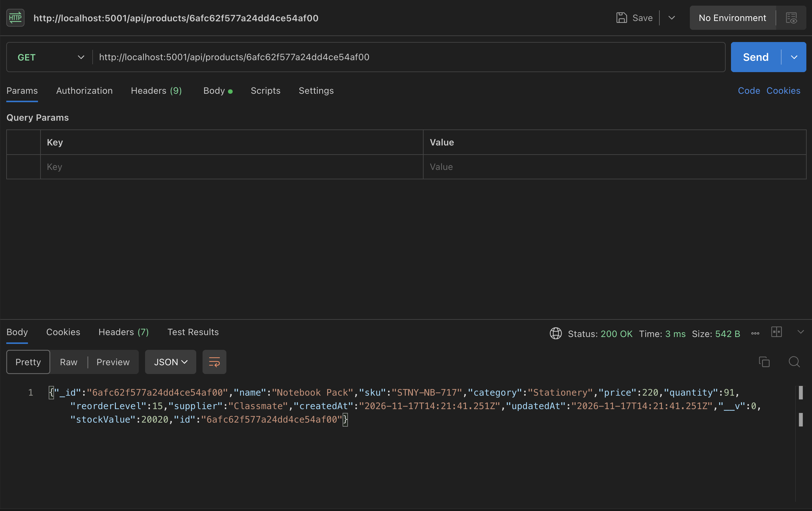
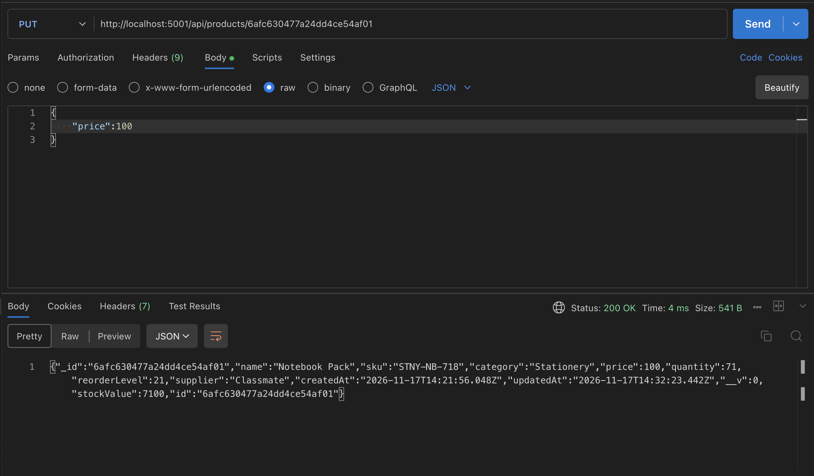
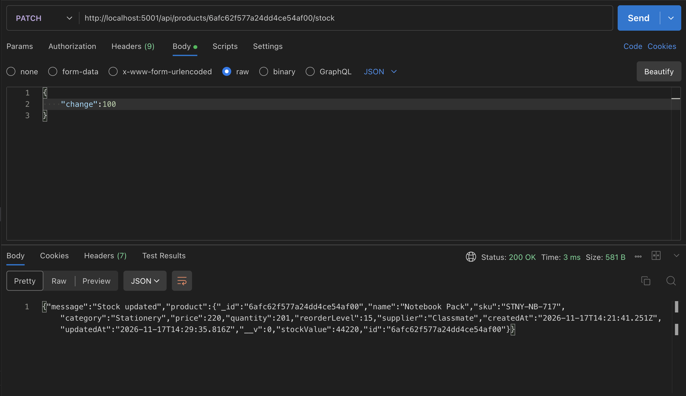
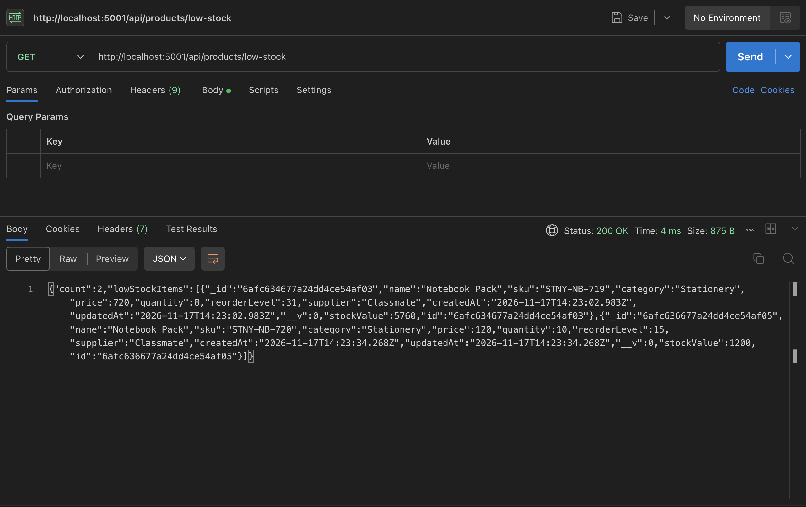
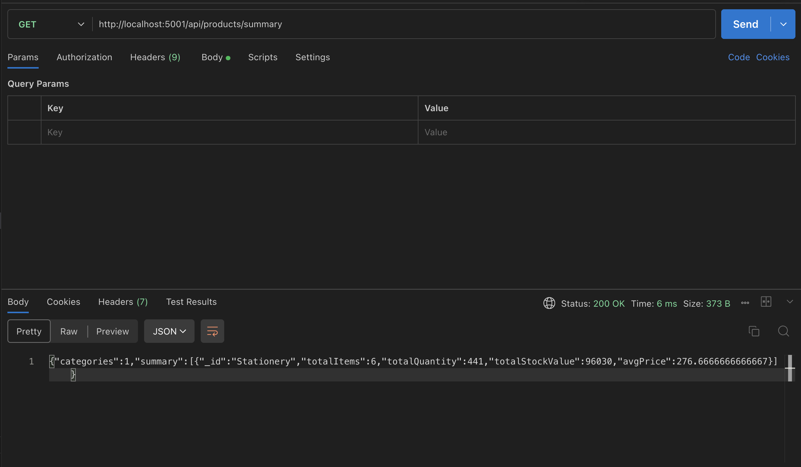

# web-dev-Assignment-3
# Inventory and Data Management System

A REST API built with Node.js, Express.js, MongoDB and Mongoose to manage a product catalogue.

## Setup
1. `npm install`
2. Create a `.env` file:
   ```
   PORT=5000
   MONGO_URI=mongodb://127.0.0.1:27017/inventory_db
   ```
3. `node server.js`

## API Endpoints
| Method | URL | Purpose |
|---|---|---|
| POST | /api/products | Create product |
| GET | /api/products | List with filter, sort, pagination |
| GET | /api/products/:id | Get single product |
| PUT | /api/products/:id | Update product |
| PATCH | /api/products/:id/stock | Restock or sale |
| DELETE | /api/products/:id | Delete product |
| GET | /api/products/low-stock | Low-stock report |
| GET | /api/products/summary | Category-wise summary |

## Postman Screenshots

### Create Product (POST)


### Get All Products (GET)


### Get Single Product (GET)


### Update Product (PUT)


### Stock Adjustment (PATCH)


### Low-Stock Report (GET)


### Category Summary (GET)

=======
# WEB-DEVELOPMENT-ASSIGNMENT-3
>>>>>>> d5155380773e81941d3ac3390a38c2d8992f9f94
